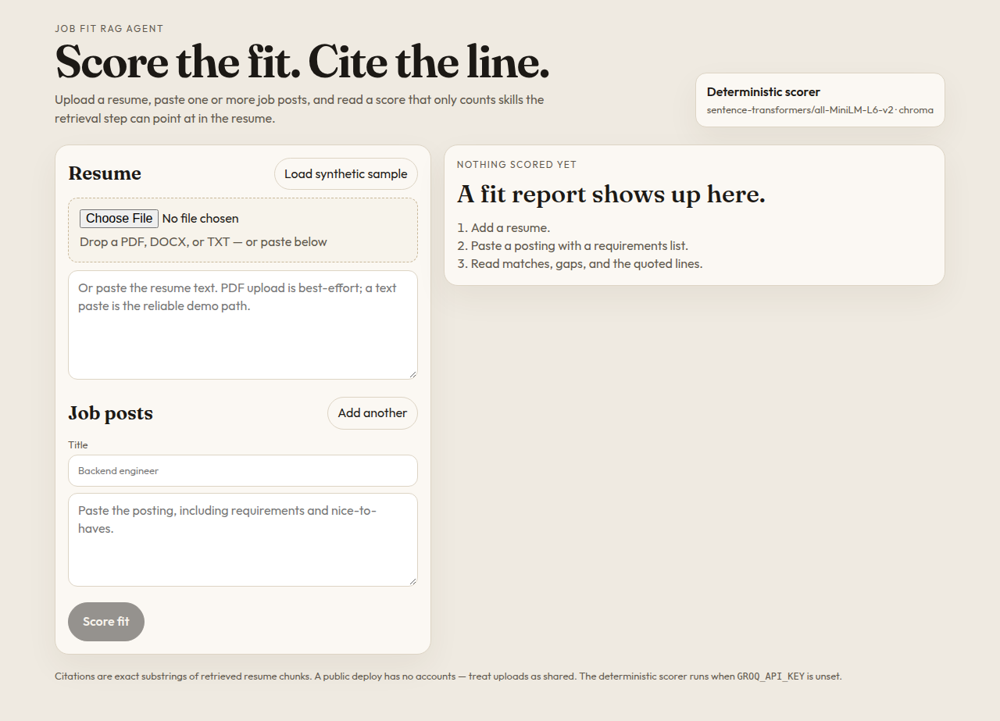
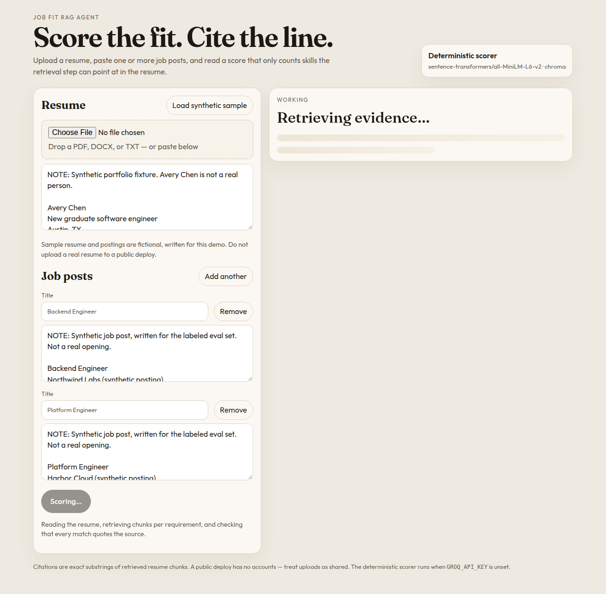
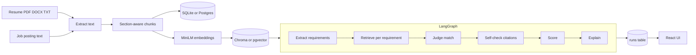

# Job Fit RAG Agent

Upload a resume and a job post. A retrieval agent scores the fit and cites the resume lines it used.

Repository: [github.com/Anshul3977/job-fit-rag-agent](https://github.com/Anshul3977/job-fit-rag-agent)

**Live demo:** [job-fit-rag-agent.onrender.com](https://job-fit-rag-agent.onrender.com). It runs on Render's free tier, so the first request after inactivity may take ~30–60s to wake up. The public demo runs the deterministic scorer (no LLM key configured), so it works best with the built-in sample resume and job descriptions. Screenshots below are from a local run with that scorer and local MiniLM embeddings.





The report above is Avery Chen, a **synthetic** resume, scored against a synthetic backend posting. 93/100, strong, with quotes. The same resume against a platform posting is 64/100, maybe, and Kubernetes is a gap:


Mobile: [docs/screenshots/05-results-mobile.png](docs/screenshots/05-results-mobile.png). The form before scoring: [docs/screenshots/02-sample-loaded.png](docs/screenshots/02-sample-loaded.png).

## Architecture



The score is not a free-form model opinion. The model, or the deterministic stand-in, proposes judgments. A pure function turns those judgments into 0–100. A self-check drops any match whose quote is not an exact substring of a retrieved chunk.

## Features

- Ingest a resume as PDF, DOCX, TXT, or pasted text. Paste one to three job posts.
- Section-aware chunking (Experience, Projects, Skills, Requirements, and so on) with overlap on long sections.
- Local embeddings: `sentence-transformers/all-MiniLM-L6-v2` through fastembed (ONNX, no torch, no paid embedding API).
- Chroma by default. pgvector when `DATABASE_URL` is Postgres and `VECTOR_BACKEND=pgvector`.
- Hybrid retrieval: dense search, plus a lexical backfill so a line that literally says Docker is not missed when the job says Docker.
- LangGraph: extract requirements, retrieve evidence per requirement, judge, self-check, score, explain.
- Groq when `GROQ_API_KEY` is set (`openai/gpt-oss-20b` by default). A deterministic scorer runs the same graph when the key is empty, so the demo and the tests do not need a network LLM.
- Negated mentions ("I have not shipped FastAPI") are not counted as experience.
- Every fit is stored in SQL and can be read back from `GET /runs/{run_id}`.
- Structured errors (`error_code`, `message`, `details`, `request_id`), upload limits, and a per-IP limit on `/fit`.

## Tech stack

Python 3.11, FastAPI, Pydantic v2, SQLAlchemy, LangGraph, Chroma, fastembed, Groq HTTP API, React, Vite, pytest, ruff, Docker.

## Measured results

From `python eval/run_eval.py` on 12 Nov 2026. Full write-up: [eval/results.md](eval/results.md). Raw rows: [eval/results.json](eval/results.json).

The set is **synthetic** (5 fictional resumes, 4 fictional postings, 20 pairs). Labels follow a technology-presence rubric: strong means every required technology is present, maybe means a real subset is present, skip means the required stack is largely absent. This is not a hiring-committee judgment and not a Groq run.

| Metric | Value |
| --- | --- |
| Verdict accuracy | 100.0% (20/20) |
| Adjacent agreement | 100.0% |
| Majority-class baseline (always `skip`) | 60.0% |
| Required-skill hit rate | 100.0% |
| Unsupported-skill rejection rate | 100.0% |
| Citation validity | 100.0% |
| Lexical recall@5 | 100.0% |
| Paraphrase-probe recall@5 | 100.0% (8 probes) |
| Fit latency p50 / p95 | 25.0 ms / 30.1 ms |
| Retrieve p50 / generate p50 | 20.0 ms / 1.0 ms |
| Mean prompt / completion tokens | 1340.3 / 327.9 (character/4 estimates) |
| Mean cost | $0.000000 |
| Failures | 0 |

Machine: Linux x86_64, 4 CPUs, Python 3.11.18, in-process Starlette TestClient, model already on disk. No browser hop. The deterministic provider made no Groq call, so cost is $0 rather than a Groq bill. When Groq is used, `app/agent/pricing.py` prices `openai/gpt-oss-20b` at $0.075 / 1M input tokens and $0.30 / 1M output tokens (Groq models page, checked 2026-11-12). The free tier still bills $0.

An earlier pass of the same script, before negated sentences were excluded, scored **85.0%** verdict accuracy. The three misses were a negated FastAPI line counted as a match, a negated Python line counted as a match, and a "TypeScript rather than JavaScript" bullet that required both languages. The table above is the re-run after those fixes.

Do not quote 100% as accuracy on real resumes. Twenty labeled pairs written to a rubric the scorer implements will look tidy. The citation check and the negation check are the parts worth trusting.

## Run it

```bash
git clone https://github.com/Anshul3977/job-fit-rag-agent.git
cd job-fit-rag-agent
python3.11 -m venv .venv
source .venv/bin/activate
pip install -r requirements.txt -r requirements-dev.txt
cp .env.example .env
uvicorn app.main:app --host 0.0.0.0 --port 8741
```

Open http://127.0.0.1:8741 for the UI and http://127.0.0.1:8741/docs for OpenAPI. Click **Load synthetic sample**, then **Score fit**.

Frontend dev server, against that API:

```bash
npm --prefix frontend install
npm --prefix frontend run dev
```

Vite is on http://127.0.0.1:5174 and proxies the API.

Docker, one process, UI included:

```bash
cp .env.example .env   # optional; compose does not require the file
docker compose up --build
```

http://127.0.0.1:8741 . Compose bind-mounts `./data/models` for the MiniLM files. The first fit downloads them from Hugging Face when that directory is empty.

Postgres and pgvector, local only, password `jobfit` is a dev default:

```bash
docker compose -f docker-compose.yml -f docker-compose.postgres.yml --profile postgres up --build
```

## Tests and evals

```bash
ruff check . && ruff format --check .
pytest -q
python eval/run_eval.py
```

Tests use a hash embedder and the deterministic scorer so CI does not download a model or call Groq. The eval script defaults to fastembed. Set `EVAL_USE_GROQ=1` only when you want the labeled set to spend Groq tokens; that number is not the one in the table above.

`eval/labels.json` is marked `"synthetic": true`. The script refuses to run if that flag is missing.

## API

| Method | Path | Purpose |
| --- | --- | --- |
| GET | `/health` | Liveness |
| GET | `/ready` | Database, vector store, which scorer is active |
| POST | `/ingest/resume` | PDF, DOCX, TXT, MD, or pasted text |
| POST | `/ingest/job` | JSON `{text, title?}` |
| POST | `/ingest/job/file` | Job as PDF, DOCX, or text |
| GET | `/jobs/{id}` `/resumes/{id}` | Stored documents |
| POST | `/fit` | One resume, one `job_id` or raw `job_text` |
| POST | `/fit/batch` | One resume, up to five jobs |
| GET | `/runs/{run_id}` | Persisted report |
| GET | `/debug/retrieve` | Ranked chunks. Only when `ENV=dev` and `DEBUG_ROUTES=true` |
| GET | `/samples` | Synthetic resume and two postings |

Errors look like `{"error_code": "EMPTY_DOCUMENT", "message": "...", "details": {}, "request_id": "..."}`. Uploads over 5 MB and unknown file types return 422. LLM failures return 503, not a hang. `/fit` is limited to 10 requests per minute per IP.

## Design decisions

- **One graph, two providers.** Groq and the deterministic scorer share the nodes. Tests and a laptop demo do not depend on a key. If the key is set and Groq fails, the request is a 503. It does not silently switch scorers mid-report.
- **The score is code.** Required items are 85% of the score, preferred items 15%. A required miss blocks `strong` even when the number is high. `strong` is every required item matched and score ≥ 75. `maybe` is required coverage ≥ 0.45 and score ≥ 45. Otherwise `skip`. Partial credit is 0.45. A bullet with "or" counts if either skill is present. Text after "rather than" is not a requirement.
- **Citations are substrings.** The self-check throws away a match it cannot snap back onto the chunk. Recommended edits say to add a bullet only if the work is real.
- **MiniLM via ONNX.** fastembed keeps the image smaller than torch and still runs `all-MiniLM-L6-v2`. Hash embeddings exist for tests only.
- **SQL for the records, a vector store for the chunks.** SQLite is the default. Postgres metadata works with the same models. pgvector is a second backend, not a second product.
- **No accounts.** A public demo is easier to review and unsafe for a real resume. The UI says so.

## Limitations

- Not a hiring decision and not an application writer. It will not invent employers, years, or tools, and it will not fill out a form.
- The skill list is a finite alias table. A paraphrase with none of those words can still be retrieved, then judged as a gap if the judge cannot ground it.
- Negation is "the word not/no/never/without appears before the skill in the sentence." It will miss clever wording.
- PDF text extraction fails on scans. Paste the text.
- English only. One process. The rate limit is in memory and resets on restart.
- Eval latency is a warm in-process CPU measurement. A free host that slept will be slower, and the first request may spend time downloading the embedding model.
- Anyone who can open a public deploy can read what was uploaded.

## Deploy

No paid resources are required. Do not put a real resume on a public URL.

### Hugging Face Spaces (Docker, free CPU)

1. Create a Space. SDK: Docker. Visibility: public. Hardware: CPU basic.
2. Point the Space at [Anshul3977/job-fit-rag-agent](https://github.com/Anshul3977/job-fit-rag-agent), or push that repo to the Space.
3. The image listens on `$PORT`, default **7860**, which Spaces expects.
4. Secrets and variables:

| Name | Value |
| --- | --- |
| `GROQ_API_KEY` | optional secret. Empty keeps the deterministic scorer |
| `GROQ_MODEL` | `openai/gpt-oss-20b` |
| `LLM_PROVIDER` | `auto` |
| `ENV` | `prod` |
| `DEBUG_ROUTES` | `false` |
| `EMBEDDING_BACKEND` | `fastembed` |

5. Open the Space URL. `/health` should return `{"status":"ok"}`. The first **Score fit** downloads MiniLM; a sleeping free Space can take about 30 seconds to wake.

### Render (Docker, free web service)

`render.yaml` is a Blueprint for this. In the Render dashboard: **New → Blueprint**, and select [Anshul3977/job-fit-rag-agent](https://github.com/Anshul3977/job-fit-rag-agent). It creates one Docker web service on the **free** plan (0.1 CPU, 512 MB), health check `/health`, branch `main`.

Render sets `PORT`. The image runs `uvicorn --port $PORT` with one worker. After a fit with MiniLM loaded, the process was about **280 MiB** RSS, inside the 512 MB limit. OpenMP and OpenBLAS are pinned to one thread so they do not multiply that.

The Blueprint prompts for `GROQ_API_KEY` (`sync: false`, so the value stays in the dashboard). Leave it empty to keep the deterministic scorer. The other variables are set in the file:

| Name | Value |
| --- | --- |
| `GROQ_API_KEY` | dashboard prompt, optional |
| `GROQ_MODEL` | `openai/gpt-oss-20b` |
| `LLM_PROVIDER` | `auto` |
| `ENV` | `prod` |
| `DEBUG_ROUTES` | `false` |
| `EMBEDDING_BACKEND` | `fastembed` |
| `EMBEDDING_MODEL` | `sentence-transformers/all-MiniLM-L6-v2` |
| `VECTOR_BACKEND` | `chroma` |

Free instances spin down and have no persistent disk, so SQLite resets on redeploy. The live service is [job-fit-rag-agent.onrender.com](https://job-fit-rag-agent.onrender.com). The first request after sleep can take about 30–60 seconds, and the first fit downloads MiniLM.

### Vercel (frontend only)

The API does not fit a Vercel function. Chroma, fastembed, and the ONNX model belong in the Docker host above.

1. Import the repo. Root directory: `frontend`. Framework: Vite.
2. Environment: `VITE_API_BASE` = the public API origin, no trailing slash. Example: `https://your-service.onrender.com`.
3. On the API host, set `CORS_ORIGINS` to the Vercel origin, for example `https://your-app.vercel.app`.
4. Redeploy both after the origin is known.

### What not to set

Do not commit `.env`. Do not point `VECTOR_BACKEND=pgvector` at a database without the `vector` extension. Do not set `EMBEDDING_BACKEND=hash` on a deploy you show people. That embedder is a test double.

## Resume lines

Only the measured deterministic run. Delete a clause rather than guessing a Groq number.

> Built a Job-Fit RAG agent (FastAPI, LangGraph, Chroma, local MiniLM) that scores a resume against a job post and cites the supporting lines. On 20 synthetic pairs: 100% agreement with technology-presence labels (60% majority-class baseline), 100% citation validity, paraphrase recall@5 100%, in-process p95 30.1 ms. Groq is wired; these figures are from the deterministic scorer.

> Designed the FastAPI service for ingest, retrieval, and fit scoring with Pydantic validation, structured errors, SQL run history, Docker, and GitHub Actions. In-process `/fit` p95 30.1 ms on the labeled set.

## License

MIT. Copyright 2026 Anshul Palarpwar.
