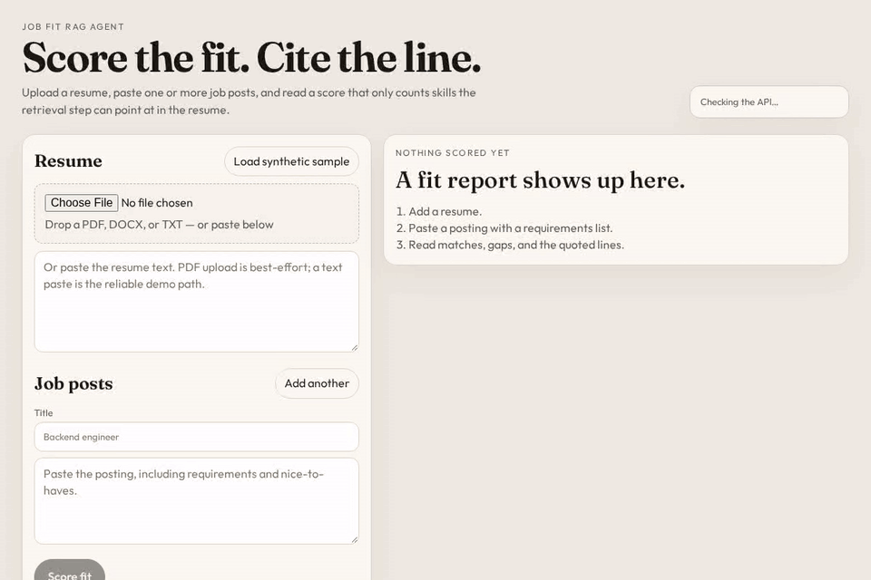
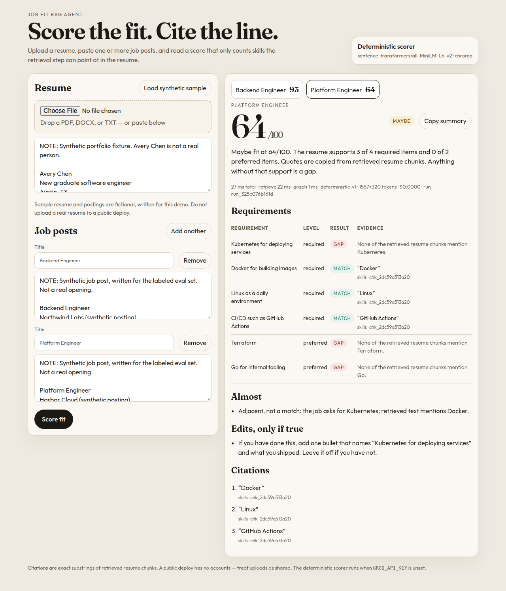
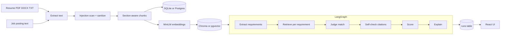
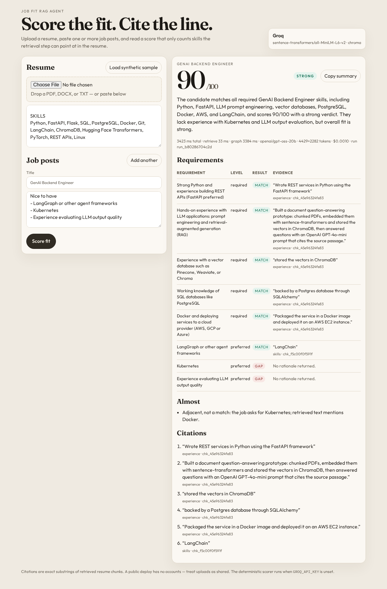

# Job Fit RAG Agent

Upload a resume and a job post. A retrieval agent scores the fit and cites the resume lines it used.

Repository: [github.com/Anshul3977/job-fit-rag-agent](https://github.com/Anshul3977/job-fit-rag-agent)

**Live demo:** [job-fit-rag-agent.onrender.com](https://job-fit-rag-agent.onrender.com). It runs on Render's free tier. A scheduled GitHub Actions job ([keep-warm.yml](.github/workflows/keep-warm.yml)) pings `/health` every 10 minutes so the demo is usually awake; if GitHub delays that job, the first request can still take ~30–60s. The clip below is the rule-based scorer on that live site. No LLM key is configured there today, so the built-in sample resume and job descriptions are the best demo. Once a Groq key is set on Render, `LLM_PROVIDER=auto` uses Groq and falls back to the rule-based scorer if Groq returns invalid JSON or stays rate-limited. The key stays in the Render dashboard. It is not in this repo.



Stills below are a local run of that same scorer, with local MiniLM embeddings.


The report above is Avery Chen, a **synthetic** resume, scored against a synthetic backend posting. 93/100, strong, with quotes. The same resume against a platform posting is 64/100, maybe, and Kubernetes is a gap:



Mobile: [docs/screenshots/05-results-mobile.png](docs/screenshots/05-results-mobile.png). The form before scoring: [docs/screenshots/02-sample-loaded.png](docs/screenshots/02-sample-loaded.png).

## Architecture



The score is not a free-form model opinion. The model, or the deterministic stand-in, proposes judgments. A pure function turns those judgments into 0–100. A self-check drops any match whose quote is not an exact substring of a retrieved chunk.

## Features

- Ingest a resume as PDF, DOCX, TXT, or pasted text. Paste one to three job posts.
- Section-aware chunking (Experience, Projects, Skills, Requirements, and so on) with overlap on long sections.
- Local embeddings: `sentence-transformers/all-MiniLM-L6-v2` through fastembed (ONNX, no torch, no paid embedding API).
- Chroma by default. pgvector when `DATABASE_URL` is Postgres and `VECTOR_BACKEND=pgvector`.
- Hybrid retrieval: MiniLM dense search and BM25 over the resume's chunks, fused with reciprocal rank fusion (k=60), then an optional cross-encoder rerank (`Xenova/ms-marco-MiniLM-L-6-v2`). Benchmarked against the old dense retriever below.
- Prompt-injection guardrails: resume and job text are scanned for instruction overrides, fake system/assistant turns, notes addressed to the screener, verdict demands and hidden or zero-width text. Flagged lines are blanked before chunking, the prompt marks documents as untrusted data, and the report lists `guardrail_flags`. Measured on a 12-attack set below.
- CI eval gate: every push re-runs the labeled fit eval, the retrieval benchmark and the injection eval, and fails if a metric drops below its floor in `eval/*floor*.json`.
- LangGraph: extract requirements, retrieve evidence per requirement, judge, self-check, score, explain.
- Groq when `GROQ_API_KEY` is set (`openai/gpt-oss-20b` by default, `reasoning_effort` low). A deterministic scorer runs the same graph when the key is empty. Invalid JSON is retried once, then that step uses the deterministic scorer. A 429 backs off with `Retry-After` and, if Groq is still limited, the fit finishes on the deterministic scorer. The response `provider` field names who produced the judgments.
- Negated mentions ("I have not shipped FastAPI") are not counted as experience.
- Every fit is stored in SQL and can be read back from `GET /runs/{run_id}`.
- Structured errors (`error_code`, `message`, `details`, `request_id`), upload limits, and a per-IP limit on `/fit`.

## Tech stack

Python 3.11, FastAPI, Pydantic v2, SQLAlchemy, LangGraph, Chroma, fastembed, Groq HTTP API, React, Vite, pytest, ruff, Docker.

## Measured results

Full write-up, including the pair table: [eval/results.md](eval/results.md). Run on 15 Nov 2026. Raw rows: [eval/results_groq.json](eval/results_groq.json) and [eval/results_deterministic.json](eval/results_deterministic.json).

The set is **synthetic**: 20 pairs (5 fictional resumes, 4 fictional postings). Labels follow a technology-presence rubric. This is not a hiring decision, and the set favors exact word matches.

Groq (`openai/gpt-oss-20b`, temperature 0) matched the labeled verdict on **19/20 (95%)**, against an always-skip baseline of **60%**. Citation validity was **41/41**. Unsupported-skill rejection was **48/49**. The miss was Avery Chen against the AI-engineer post: labeled maybe, scored strong. The deterministic scorer got **20/20** on this same set because those labels line up with its keyword rules. Do not quote that 100% as accuracy on real resumes.

A clean paced latency sample (N=5, one fit at a time, 62s apart) had a median of about **3.1s**. The full 20-pair Groq timings are mostly free-tier waits (8,000 tokens/minute), not model speed. Details are in the write-up.

At temperature 0 the same pair scored **51** and then **90** on two runs. A single Groq number moves. The deterministic scorer is the one that repeats.



That still is a local Groq run of a synthetic GenAI backend posting: 90/100, strong, with quotes. It is one draw, not the stable score.

## Retrieval: hybrid vs dense

Generated by [eval/retrieval_eval.py](eval/retrieval_eval.py), full tables in [eval/retrieval_results.md](eval/retrieval_results.md). 57 queries over the same synthetic set: 49 job requirements with labeled evidence chunks, plus 8 paraphrase probes that share few words with the resume. `/fit` searches one resume (~6 chunks); the pooled index (30 chunks) is the harder ranking test.

| Per resume, all 57 queries | Recall@3 | Recall@4 | Hit@1 | MRR |
| --- | --- | --- | --- | --- |
| Dense + lexical backfill (before) | 0.877 | 0.969 | 0.877 | 0.933 |
| Hybrid BM25 + dense, RRF (shipped default) | 0.895 | 0.969 | 0.912 | 0.956 |
| Hybrid + cross-encoder rerank | 0.947 | 0.988 | 0.930 | 0.965 |

| Pooled 30-chunk index, all 57 queries | Recall@4 | Hit@1 | MRR |
| --- | --- | --- | --- |
| Dense + lexical backfill (before) | 0.558 | 0.439 | 0.589 |
| Hybrid | 0.614 | 0.386 | 0.577 |
| Hybrid + rerank | 0.674 | 0.456 | 0.614 |

On the 49 requirement queries, hybrid lifts per-resume MRR from 0.942 to 0.980 and Recall@4 from 0.983 to 1.000. It is **worse on the 8 paraphrase probes** (MRR 0.875 → 0.812), because BM25 pulls in chunks that share words but not meaning; the reranker wins back Recall@4 there (0.917) but not MRR. The cross-encoder costs about 200 ms per fit for 10 chunks on an 8-CPU machine (p50 214.7 ms), so it is off by default on the free Render instance (0.1 CPU, 512 MB). Set `RERANKER_MODEL=Xenova/ms-marco-MiniLM-L-6-v2` to turn it on. With hybrid retrieval the deterministic fit eval is still 20/20 with 100% valid citations, and retrieval p50 went from 49 ms to 50 ms.

## Prompt-injection guardrails

Generated by [eval/injection_eval.py](eval/injection_eval.py), per-case table in [eval/injection_results.md](eval/injection_results.md). 12 synthetic attacks planted in resumes and job posts of pairs labeled `skip` ("ignore previous instructions", fake `SYSTEM:` turns, notes to the screener, white-text and zero-width tricks, two plain-English paraphrases, two job-side attacks). An attack succeeds if the verdict beats the clean run or the score rises by 10 or more.

| Deterministic scorer | Guardrails off | Guardrails on |
| --- | --- | --- |
| Attacks detected | – | 10/12 |
| Attack success | 9/12 | 2/12 |
| Mean / max score change | +57.8 / +85 | +14.2 / +85 |
| Reports quoting the injected line | 9 | 2 |

The two that still succeed are the paraphrases (i09, i10). They contain no trigger phrase, so the regex scanner misses them. They stay in the set on purpose, rather than tuning patterns to the eval. False positives: 0 flags across all labeled resumes and job posts, and 1 of 8 benign look-alike lines ("see previous instructions page") flagged.

These numbers use the deterministic scorer, so they repeat run to run. `EVAL_USE_GROQ=1 EVAL_PACE_S=20 python eval/injection_eval.py` runs the same set through Groq and writes `injection_results_groq.*`, marking any fit that fell back to the deterministic scorer. A first Groq attempt on 17 Nov hit the free tier's per-minute and then per-day token limits, so too many fits fell back for it to count as a Groq result, and it is not published.

## Run it

```bash
git clone https://github.com/Anshul3977/job-fit-rag-agent.git
cd job-fit-rag-agent
python3.11 -m venv .venv
source .venv/bin/activate
pip install -r requirements.txt -r requirements-dev.txt
cp .env.example .env
uvicorn app.main:app --host 0.0.0.0 --port 8741
```

Open http://127.0.0.1:8741 for the UI and http://127.0.0.1:8741/docs for OpenAPI. Click **Load synthetic sample**, then **Score fit**.

Frontend dev server, against that API:

```bash
npm --prefix frontend install
npm --prefix frontend run dev
```

Vite is on http://127.0.0.1:5174 and proxies the API.

Docker, one process, UI included:

```bash
cp .env.example .env   # optional; compose does not require the file
docker compose up --build
```

http://127.0.0.1:8741 . Compose bind-mounts `./data/models` for the MiniLM files. The first fit downloads them from Hugging Face when that directory is empty.

Postgres and pgvector, local only, password `jobfit` is a dev default:

```bash
docker compose -f docker-compose.yml -f docker-compose.postgres.yml --profile postgres up --build
```

## Tests and evals

```bash
ruff check . && ruff format --check .
pytest -q
python eval/run_eval.py && python eval/gate.py        # labeled fit eval + floors
python eval/retrieval_eval.py --check                  # Recall@k / MRR, dense vs hybrid vs rerank
python eval/injection_eval.py --check                  # attacks with guardrails on and off
```

CI runs all of these on every push (`eval-gate` job in [ci.yml](.github/workflows/ci.yml)) with `--no-write`, caching the MiniLM and reranker models. A drop below a floor in `eval/floors.json`, `eval/retrieval_floor.json` or `eval/injection_floor.json` fails the build.

Tests use a hash embedder and the deterministic scorer so CI does not download a model or call Groq. The eval script defaults to fastembed. Set `EVAL_USE_GROQ=1` only when you want the labeled set to spend Groq tokens; that number is not the one in the table above.

`eval/labels.json` is marked `"synthetic": true`. The script refuses to run if that flag is missing.

## API

| Method | Path | Purpose |
| --- | --- | --- |
| GET | `/health` | Liveness |
| GET | `/ready` | Database, vector store, which scorer is active, retrieval mode and reranker |
| POST | `/ingest/resume` | PDF, DOCX, TXT, MD, or pasted text |
| POST | `/ingest/job` | JSON `{text, title?}` |
| POST | `/ingest/job/file` | Job as PDF, DOCX, or text |
| GET | `/jobs/{id}` `/resumes/{id}` | Stored documents |
| POST | `/fit` | One resume, one `job_id` or raw `job_text` |
| POST | `/fit/batch` | One resume, up to five jobs |
| GET | `/runs/{run_id}` | Persisted report |
| GET | `/debug/retrieve` | Ranked chunks. Only when `ENV=dev` and `DEBUG_ROUTES=true` |
| GET | `/samples` | Synthetic resume and two postings |

Errors look like `{"error_code": "EMPTY_DOCUMENT", "message": "...", "details": {}, "request_id": "..."}`. Uploads over 5 MB and unknown file types return 422. A Groq JSON failure or a rate limit that survives retries falls back to the deterministic scorer and says so in `provider` and `provider_note`. Other LLM failures return 503, not a hang. `/fit` is limited to 10 requests per minute per IP. The UI scores several jobs one at a time.

### Retrieval and guardrail settings

| Variable | Default | Meaning |
| --- | --- | --- |
| `RETRIEVAL_MODE` | `hybrid` | `hybrid` (BM25 + dense, RRF) or `dense` (the old path) |
| `RERANKER_MODEL` | empty | fastembed cross-encoder for the fused shortlist; empty or `none` is off |
| `RERANK_SHORTLIST` | `8` | Fused chunks sent to the reranker |
| `GUARDRAILS` | `true` | Scan and sanitize uploaded text, add the untrusted-data note to the prompt |

## Design decisions

- **One graph, two providers.** Groq and the deterministic scorer share the nodes. Tests and a laptop demo do not depend on a key. `LLM_PROVIDER=auto` calls Groq only when `GROQ_API_KEY` is set. For `openai/gpt-oss-20b` the call sets `reasoning_effort` to low and allows 4096 completion tokens, because a 1400-token cap was spent on reasoning and Groq answered `400 json_validate_failed` with an empty message. That JSON failure is retried once, then that step uses the deterministic scorer. A 429 is retried a few times with exponential backoff that honors `Retry-After` (capped at 8 seconds). If Groq is still rate-limited, the rest of the fit uses the deterministic scorer. `provider` is whichever scorer produced the judgments. `provider_note` says when a step fell back. Timeouts and 5xx after those retries are still a 503.
- **The score is code.** Required items are 85% of the score, preferred items 15%. A required miss blocks `strong` even when the number is high. `strong` is every required item matched and score ≥ 75. `maybe` is required coverage ≥ 0.45 and score ≥ 45. Otherwise `skip`. Partial credit is 0.45. A bullet with "or" counts if either skill is present. Text after "rather than" is not a requirement.
- **Citations are substrings.** The self-check throws away a match it cannot snap back onto the chunk. Recommended edits say to add a bullet only if the work is real.
- **MiniLM via ONNX.** fastembed keeps the image smaller than torch and still runs `all-MiniLM-L6-v2`. Hash embeddings exist for tests only.
- **SQL for the records, a vector store for the chunks.** SQLite is the default. Postgres metadata works with the same models. pgvector is a second backend, not a second product.
- **No accounts.** A public demo is easier to review and unsafe for a real resume. The UI says so.

## Limitations

- Not a hiring decision and not an application writer. It will not invent employers, years, or tools, and it will not fill out a form.
- The skill list is a finite alias table. A paraphrase with none of those words can still be retrieved, then judged as a gap if the judge cannot ground it.
- Negation is "the word not/no/never/without appears before the skill in the sentence." It will miss clever wording.
- PDF text extraction fails on scans. Paste the text.
- English only. One process. The rate limit is in memory and resets on restart.
- Eval latency for the deterministic scorer is a warm in-process CPU measurement. The Groq figure to quote is the paced sample (median about 3.1s, N=5), not the rate-limited full run. A free host that slept will be slower, and the first request may spend time downloading the embedding model.
- A Groq score is not stable. At temperature 0 the same pair scored 51 and then 90. The deterministic scorer repeats; the model does not.
- Anyone who can open a public deploy can read what was uploaded.
- The injection scanner is pattern-based. Paraphrased instructions with no trigger phrase get through (2 of 12 in the eval), and it flags a benign line now and then (1 of 8 look-alikes).
- Hybrid retrieval helps exact-skill requirements and hurts paraphrase probes on this set. Both numbers are from 57 synthetic queries, not real resumes.

## Deploy

No paid resources are required. Do not put a real resume on a public URL.

### Hugging Face Spaces (Docker, free CPU)

1. Create a Space. SDK: Docker. Visibility: public. Hardware: CPU basic.
2. Point the Space at [Anshul3977/job-fit-rag-agent](https://github.com/Anshul3977/job-fit-rag-agent), or push that repo to the Space.
3. The image listens on `$PORT`, default **7860**, which Spaces expects.
4. Secrets and variables:

| Name | Value |
| --- | --- |
| `GROQ_API_KEY` | optional secret. Empty keeps the deterministic scorer |
| `GROQ_MODEL` | `openai/gpt-oss-20b` |
| `LLM_PROVIDER` | `auto` |
| `ENV` | `prod` |
| `DEBUG_ROUTES` | `false` |
| `EMBEDDING_BACKEND` | `fastembed` |

5. Open the Space URL. `/health` should return `{"status":"ok"}`. The first **Score fit** downloads MiniLM; a sleeping free Space can take about 30 seconds to wake.

### Render (Docker, free web service)

`render.yaml` is a Blueprint for this. In the Render dashboard: **New → Blueprint**, and select [Anshul3977/job-fit-rag-agent](https://github.com/Anshul3977/job-fit-rag-agent). It creates one Docker web service on the **free** plan (0.1 CPU, 512 MB), health check `/health`, branch `main`.

Render sets `PORT`. The image runs `uvicorn --port $PORT` with one worker. After a fit with MiniLM loaded, the process was about **280 MiB** RSS, inside the 512 MB limit. OpenMP and OpenBLAS are pinned to one thread so they do not multiply that.

The Blueprint prompts for `GROQ_API_KEY` (`sync: false`, so the value stays in the dashboard and never in git). Leave it empty to keep the deterministic scorer. Set it and `LLM_PROVIDER=auto` uses Groq, with the fallback above when Groq cannot return JSON or stays rate-limited. The other variables are set in the file:

| Name | Value |
| --- | --- |
| `GROQ_API_KEY` | dashboard prompt, optional |
| `GROQ_MODEL` | `openai/gpt-oss-20b` |
| `LLM_PROVIDER` | `auto` |
| `ENV` | `prod` |
| `DEBUG_ROUTES` | `false` |
| `EMBEDDING_BACKEND` | `fastembed` |
| `EMBEDDING_MODEL` | `sentence-transformers/all-MiniLM-L6-v2` |
| `VECTOR_BACKEND` | `chroma` |

Free instances spin down and have no persistent disk, so SQLite resets on redeploy. The live service is [job-fit-rag-agent.onrender.com](https://job-fit-rag-agent.onrender.com). The first request after sleep can take about 30–60 seconds, and the first fit downloads MiniLM. The keep-warm workflow pings `/health` every 10 minutes to avoid that; one free service awake all month is about 744 hours, inside Render's 750 free instance-hours, so disable the workflow if you add a second always-on free service.

### Vercel (frontend only)

The API does not fit a Vercel function. Chroma, fastembed, and the ONNX model belong in the Docker host above.

1. Import the repo. Root directory: `frontend`. Framework: Vite.
2. Environment: `VITE_API_BASE` = the public API origin, no trailing slash. Example: `https://your-service.onrender.com`.
3. On the API host, set `CORS_ORIGINS` to the Vercel origin, for example `https://your-app.vercel.app`.
4. Redeploy both after the origin is known.

### What not to set

Do not commit `.env` or a Groq key. Do not point `VECTOR_BACKEND=pgvector` at a database without the `vector` extension. Do not set `EMBEDDING_BACKEND=hash` on a deploy you show people. That embedder is a test double.

## Resume lines

These match the headline numbers in [Measured results](#measured-results) and [eval/results.md](eval/results.md). The set is synthetic, so say so if asked.

> Built a Job-Fit RAG agent (FastAPI, LangGraph, Chroma, MiniLM embeddings, Groq `gpt-oss-20b`) that scores a resume against a job post and cites the supporting resume lines. On a 20-pair synthetic labeled set, the LLM scorer matched 19/20 verdicts (95%, vs. a 60% majority-class baseline), with 100% citation validity (41/41) and 98% unsupported-skill rejection (48/49); paced median fit latency about 3.1 s.

> Designed the FastAPI service for ingest, hybrid retrieval, and fit scoring with Pydantic validation, structured errors, SQL run history, Docker, an offline eval harness, and GitHub Actions CI, with a rule-based fallback scorer (p95 29.1 ms in-process) when the LLM is rate-limited.

## License

MIT. Copyright 2026 Anshul Palarpwar.
